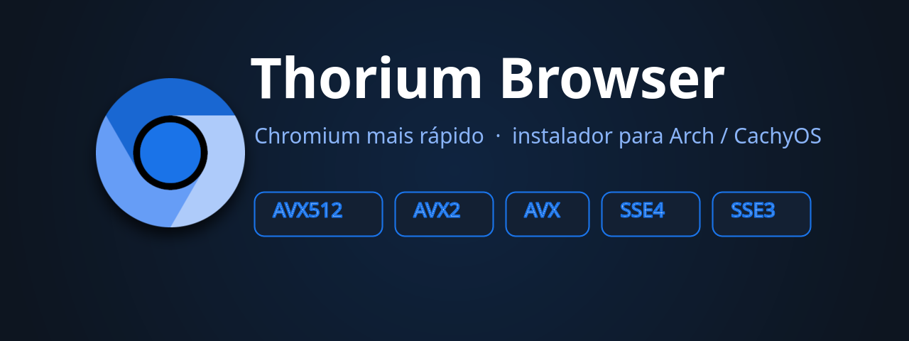

<div align="center">



# Thorium Browser — instalador para Arch / CachyOS

**O `.deb` oficial do upstream (gz83/thorium), reempacotado para Arch no GitHub Actions e instalado com `pacman -U`.**

[](LICENSE)
[](install.sh)
[]()
[](https://github.com/LucianoSkx/thorium-installer/releases)

[⬇ Instalar](#instalar) · [🗑 Desinstalar](#desinstalar) · [⚙️ Opções](#opções) · [📦 Variantes](#variantes) · [🏗 Como funciona](#como-funciona)

</div>

---

## O que é

O [Thorium](https://github.com/gz83/thorium) é um fork do Chromium focado em
performance, com patchsets próprios e **uBlock Origin embutido**.

Este repositório **não reinventa a instalação**: o GitHub Actions baixa o `.deb`
oficial do upstream, reempacota para Arch com `makepkg` e publica o
`.pkg.tar.zst`. O instalador só baixa o pacote e roda `pacman -U`.

## 📥 Instalar

```bash
curl -fsSL https://raw.githubusercontent.com/LucianoSkx/thorium-installer/main/install.sh | bash
```

O script detecta a variante de CPU, baixa o pacote certo e instala. Pede a senha do
`sudo` uma vez.

<details>
<summary>Instalar a partir de um arquivo salvo</summary>

```bash
curl -fsSL https://raw.githubusercontent.com/LucianoSkx/thorium-installer/main/install.sh -o install.sh
sudo bash install.sh
```
</details>

## 🗑 Desinstalar

```bash
curl -fsSL https://raw.githubusercontent.com/LucianoSkx/thorium-installer/main/uninstall.sh | bash
```

> Remove o pacote via `pacman -Rns`. **Seu perfil (`~/.config/thorium`) é preservado.**

## ⚙️ Opções

| Flag | O que faz |
|---|---|
| `--version <ver>` | usa uma release específica (ex: `156.0.8078.28`) |
| `--local <pkg>` | instala a partir de um `.pkg.tar.zst` já baixado |
| `--uninstall` | remove o Thorium |
| `-h`, `--help` | mostra a ajuda |

Flags de execução: cada linha do `~/.config/thorium-flags.conf` vira uma flag do Chromium (linhas vazias e `#` comentários são ignorados). No primeiro start, uma checagem de CPU avisa (`notify-send`) se o build da CPU não é compatível.

## 📦 Variantes

O instalador escolhe pelo seu processador.

| CPU / arch | asset (a versão muda a cada release) |
|---|---|
| AVX-512 | `thorium-browser_156.0.8078.28_AVX512.pkg.tar.zst` |
| AVX2 | `thorium-browser_156.0.8078.28_AVX2.pkg.tar.zst` |
| AVX | `thorium-browser_156.0.8078.28_AVX.pkg.tar.zst` |
| SSE4 | `thorium-browser_156.0.8078.28_SSE4.pkg.tar.zst` |
| SSE3 | `thorium-browser_156.0.8078.28_SSE3.pkg.tar.zst` |
| arm64 | `thorium-browser_156.0.8078.28_arm64.pkg.tar.zst` |
| i386 | `thorium-browser_156.0.8078.28_i386.pkg.tar.zst` |

Os nomes dos assets seguem o padrão do
[release original](https://github.com/gz83/thorium/releases/tag/M156.0.8078.28)
(`thorium-browser_<versão>_<variante>`).

## 🔗 Fonte original

Os pacotes vêm dos releases de [gz83/thorium](https://github.com/gz83/thorium/releases),
reempacotados com o PKGBUILD próprio deste repositório.

## 🏗 Como funciona

1. **GitHub Actions** (`.github/workflows/build.yml`) roda em container Arch:
   detecta a versão mais recente do upstream (gz83/thorium), gera o PKGBUILD
   deste repositório apontando para o `.deb` dessa release e reempacota com
   `makepkg` → `.pkg.tar.zst`
2. O pacote vai para a [release](https://github.com/LucianoSkx/thorium-installer/releases)
3. `install.sh` baixa o `.pkg.tar.zst` da variante correta, confere o `SHA256SUMS`
   da release e roda `pacman -U`

O CI roda **todo dia às 6h UTC** e recompila sozinho a versão mais recente do
upstream. Para forçar uma recompilação agora, basta criar uma tag:

```bash
git tag v156.0.8078.28 && git push origin v156.0.8078.28
```

## 📄 Licença

MIT. O Thorium é um projeto independente — veja
[github.com/gz83/thorium](https://github.com/gz83/thorium).

---

<div align="center">
<sub>Feito para a comunidade Arch · fonte dos
<a href="https://github.com/gz83/thorium">`.deb` oficiais upstream</a></sub>
</div>
